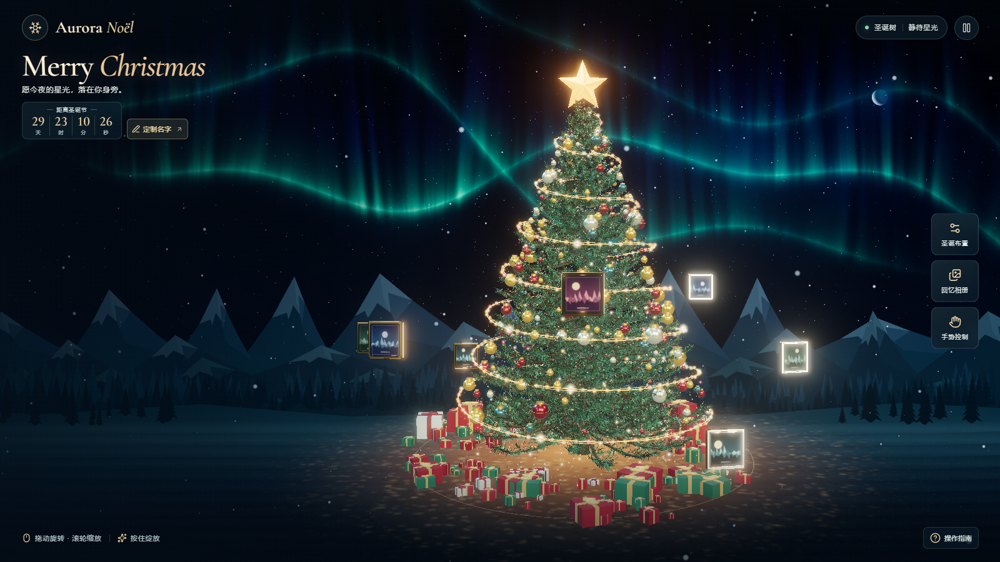

# 极光圣诞树 · Aurora Noël



在雪山与极光下实时渲染的交互式 3D 圣诞树。松针、灯串、彩球、礼盒、雪地、相册占位图全部由程序绘制，并支持摄像头手势控制与祝福分享。

## 功能

- Three.js 实时场景：粒子星尘、极光天空、飘雪、辉光后期
- 圣诞树 / 星光漂浮两种展示模式
- 圣诞布置：粒子数量、主色、点缀色、礼盒与彩球数量
- 回忆相册：照片保存在浏览器 IndexedDB，以 3D 金属相框展示
- 手势控制：MediaPipe Hands，食指移动光标、捏合抓取照片、张开手掌绽放星光
- 音乐律动：音频频谱驱动灯光与粒子
- 圣诞倒计时、名字与祝福语定制
- 祝福分享：把照片、祝福和自定义音乐打包成链接，朋友点开即可看到你的圣诞树

## 技术栈

React 19 · Three.js r181 · Vite 6 · @mediapipe/hands · @netlify/blobs · lucide-react

## 本地运行

需要 Node.js 22.12+，以及 pnpm 或 npm。

```sh
pnpm install
pnpm dev
```

打开终端显示的地址即可。追加 `?lite` 参数可以减少粒子、雪花和装饰，并关闭辉光后期。

生产构建：

```sh
pnpm build
pnpm preview
```

分享链接依赖 Serverless 存储（Cloudflare KV 或 Netlify Blobs），`pnpm dev` / 静态预览中点击「生成分享链接」会提示服务未启用，这是正常现象。

## 部署

### Cloudflare Pages（当前线上）

- 线上地址：https://aurora-noel.pages.dev
- 分享存储：Cloudflare KV（绑定名 `GIFTS_KV`），免费额度 1GB，约 140–160 份分享
- 后端：`functions/api/gift.js`
- 配置：`wrangler.toml`

```sh
npm run build
npx wrangler pages deploy dist --project-name aurora-noel --branch main
```

KV 是最终一致的，新生成的分享链接可能需要最多约 60 秒才能在全球生效；前端已内置重试。

### Netlify

分享功能需要 Netlify Functions + Netlify Blobs，必须通过 Git 集成或 Netlify CLI 构建部署；直接拖拽纯静态压缩包不会启用 Function。

1. Netlify → Add new site → Import an existing project，选择本仓库
2. Build command 填 `npm run build`，Publish directory 填 `dist`
3. 仓库内的 `netlify.toml` 已配置 Functions 目录与 Node 22

## 使用说明

- 拖动旋转，滚轮或双指缩放，按住画面绽放星光。
- 「圣诞布置」可切换模式、调整粒子与装饰，或上传本地音乐。
- 「回忆相册」支持 JPG / PNG / WEBP，照片保存在当前浏览器，不会上传。
- 「手势控制」需要摄像头权限；视频帧只在浏览器本地处理。
- 「定制祝福」可修改名字与祝福语，并在当前浏览器记住。
- 「生成分享链接」会把祝福和相册照片压缩为 WebP 上传到分享存储（Cloudflare KV 或 Netlify Blobs），返回形如 `?gift=xxxxxxxx` 的链接；链接 90 天内有效，朋友打开后看到的是你的树、相册和祝福，不会写入对方浏览器。
- 如果在「圣诞布置」里上传过本地音乐，分享时会一并同步（文件需小于 5MB）；没有自定义音乐时，朋友会听到默认曲目。

## 素材与许可

- 代码以 MIT License 开源，详见 [LICENSE](LICENSE)
- Cormorant Garamond 与 Noto Serif SC 按 SIL Open Font License 分发，许可文件位于 `public/fonts/`
- 手势识别使用 [MediaPipe Hands](https://developers.google.com/mediapipe)（Apache-2.0）
- 默认音乐为外链 Ikson《Christmas》；外链不可用时播放项目内生成的《Silent Night》八音盒编曲
